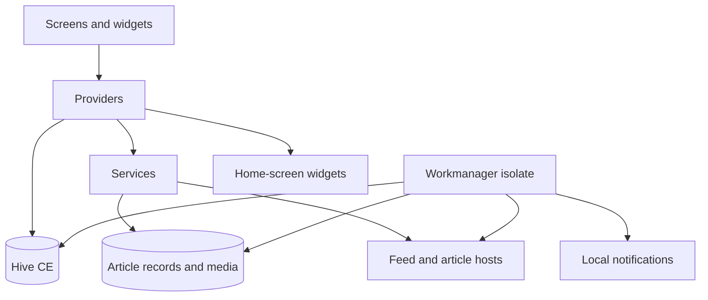

# Mimari ve Çalışma Zamanı

Kaynak koduyla karşılaştırma: 2026-10-11; kademeli ön plan yenileme bölümü 2026-10-24'te güncellendi. Çelişkide kaynak kodu esas alınır.

[Belge dizini](../README.md) · [Geliştirme ve doğrulama](README.md) · [Çevrimdışı saklama](offline-storage.md)

## Çalışma zamanı

`main()` sırası:

1. Flutter binding ve `WidgetUpdateService` başlatılır.
2. Hive CE `settings`, `feeds`, `bookmarks` kutuları açılır.
3. Eski tek-kutu şeması `_migrateHiveBoxes()` ile bir kez taşınır.
4. `NotificationService` ve Workmanager hazırlanır.
5. Bildirim/home-widget deep link akışları GoRouter'a bağlanır.
6. İzin/ad-block listesi işleri await edilmeden başlatılır; ardından `runApp` çağrılır.
7. Provider ağacı, ortak `ArticlePreparationService` ve `MyApp` oluşturulur.

## Mimari



Provider'lar:

- `SettingsProvider`: tema, dil, cache/sync, bildirim, okuma, filtre, WebView tercihleri.
- `SubscriptionProvider`: abonelik, özel kategori, kategori simgesi/sırası.
- `BookmarkProvider`: tam makale JSON'u ve hızlı ID kümesi.
- `FeedProvider`: fetch, filtre, arama, sayfalama, cache, okundu, bildirim, widget güncelleme.
- `ArticlePageProvider`: sayfa bazlı scroll, tam metin, okuma ilerlemesi.

`FeedProvider`, `ChangeNotifierProxyProvider3` ile Subscription/Settings/Bookmark alır. `filterInputsChanged` yalnız filtreyi etkileyen keyword ve bookmark girdileri değişince filtre cache'ini bozar.

Kategoriler, aboneliklerin kategori alanları ve `_customCategories` kümesinin birleşimidir. Model kaynakları `lib/models/feed_item.dart` ve `lib/models/feed_subscription.dart` içindedir; JSON serialization/copyWith ve eski kayıtlara fallback bu sınırda tutulur.

`ArticlePageProvider` makale sayfası kapsamında oluşturulur. Uygulama kökündeki `Provider<ArticlePreparationService>`, Feed/Bookmark provider'larına aynı hazırlık servisini verir; bu servis bir `ChangeNotifier` değildir.

## Kaynak kodu haritası

| Dizin | Sorumluluk |
| --- | --- |
| `lib/models/` | `FeedItem`, `FeedSubscription`, önerilen akış modeli |
| `lib/providers/` | Ekran durumu, kullanıcı tercihleri, provider koordinasyonu |
| `lib/services/` | HTTP, parse, filtre, saklama, hazırlık ve sistem entegrasyonları |
| `lib/screens/`, `lib/widgets/` | Sayfalar ve alanlarına göre ayrılmış UI bileşenleri |
| `lib/router/` | GoRouter ve onboarding oturum durumu |
| `lib/theme/`, `lib/utils/` | Tema, toast, hareket, pacing ve yardımcılar |
| `lib/l10n/` | EN/TR/ES ARB kaynakları ve üretilen Dart dosyaları |
| `android/`, `ios/` | Yerel platform yapılandırması ve widget kaynakları |
| `test/` | Birim, widget ve yaşam döngüsü regresyon testleri |

Bu tablodaki yollar depo köküne göredir.

## Kalıcılık

### `settings`

`flexScheme`, `themeMode`, `locale`, `offlineCacheLimit`, `cacheIntervalSeconds`, `syncBackground`, `notificationsEnabled`, `digestMode`, `quietHoursEnabled`, `quietHoursStart`, `quietHoursEnd`, `appFont`, `fontSize`, `typeface`, `lineSpacing`, `globalExcludedKeywords`, `searchHistory`, `adBlockEnabled`, `webviewDarkModeEnabled`, `browserMode`, `autoFullText`, `markReadOnScroll`, `articleListStyle`, `hasSeenOnboarding`, `_boxesMigrated`.

Yazı tipleri `assets/fonts` altında paketlidir (OFL lisansları lisans sayfasına `registerFontLicenses()` ile eklenir); ağdan font indirilmez. `appFont` (`outfit` varsayılan, `atkinson`, `lexend`, `literata`, `system`) arayüz temasını, `typeface` makale gövdesini belirler: `system` uygulama fontunu izler, eski `serif`/`sans-serif` değerleri Literata/Atkinson'a, `mono` platform eş aralıklı fontuna eşlenir.

Varsayılanlar: 50 cache öğesi, 1800 saniye yenileme (kayıt yok/0), arka plan açık, anlık bildirim, 22–07 sessiz saat, yerleşik tarayıcı, global tam metin kapalı.

### `feeds`

- `subscriptions`: JSON `FeedSubscription` listesi
- `custom_categories`, `category_icons`, `category_order`
- `cachedItemsJson`
- `readItemRefs`: kaynak bazlı okundu işaretleri (`(feedUrl, id)` typed key) ve henüz bağlanmamış legacy ID'ler; `readItemIds` yalnız migration girdisidir, yeniden yazılmaz. Kullanıcı işaretleri bellekte anında uygulanır, diske 1 sn sessizlikten sonra tek yazımla gider; uygulama ön plandan çıkınca ve provider kapanırken bekleyen yazım hemen yapılır
- `feedValidators`: URL bazlı ETag/Last-Modified
- `feedRedirects`: abonelik URL'sinden öğrenilen son URL'ye eşleme
- `feedBackoffUntil`, `feedBackoffUntil.bg`: ön plan ve arka plan yazarlarının ayrı cooldown snapshot'ları
- `cacheEpoch`: cache temizleme sırasında arka plan yazılarını sınırlar
- `bgKnownItemIds`: yalnız eski sürüm migration kanıtı; aktif deduplication kaynağı değildir

### `bookmarks`

`bookmarkedItemsJson` tam öğeleri; `bookmarkedItemIds` hızlı üyelik kontrolünü tutar.

Yeni kalıcı alanlarda eski kayıtlar için fallback zorunlu. `FeedSubscription.fullTextEnabled` tri-state: `null` global ayarı izler, `true` zorla açar, `false` zorla kapatır. `fullTextSchema: 2` eski `false` kayıtlarını ayırır.

### Yedek dosyası

`lib/services/app_backup.dart` tek JSON belge yazar (`format: dondurma-backup`, `version: 1`): `SettingsProvider.backupValues()` izin listesindeki ayarlar (onboarding/migration işaretleri hariç), bildirim epoch'u çıkarılmış abonelikler, klasörler/ikonlar/sıra, yer imi `FeedItem`'ları ve `(feedUrl, id)` okundu işaretleri. Görseller ve kalıcı kayıt gövdeleri yedeğe girmez; geri yüklenen yer imleri normal kaydetme yoluyla yeniden hazırlanır. Geri yükleme önce bütün belgeyi doğrular (`BackupException`: yedek değil / daha yeni sürüm), sonra kaynak, klasör, yer imi ve okundu işaretlerini ekler, ayarları değiştirir. Geri yüklenen aboneliklere yeni bildirim epoch'u verilir; ilk çekim sessiz kalır. Yeni ayar anahtarı eklerken `_backupKeys` listesine de eklenmelidir.

Hive kutularına ek olarak `ArticleRecordStore` ve `ObservedArticleStore`, foreground/Workmanager arasında lock dosyasıyla korunan ayrı JSON state dosyaları kullanır. Kalıcı medya havuzu uygulamanın documents dizinindedir. Sahiplik, hazırlık ve temizleme kuralları [çevrimdışı saklama rehberindedir](offline-storage.md).

## Feed hattı

`FeedService` ortak keep-alive `http.Client`, browser User-Agent, zaman aşımı, ETag/Last-Modified ve 304 desteği kullanır. RSS/Atom gövdesi `compute(parseFeedBody, ...)` içinde ayrıştırılır. Eksik ID için kararlı fallback üretilir; feed başına öğe sayısı sınırlandırılır.

Yanıt bir HTML sayfasıysa (`looksLikeHtmlPage`) `fetchFeed` ayrıştırmaya girmeden `FeedFetchErrorKind.parse` hatası verir ve sayfayı `FeedFetchException.page` ile taşır; ayrıştırılamayan gerçek feed'lerde `page` boştur ve keşif çalışmaz. Kaynak ekleme bu sayfayı `FeedService.discoverFeeds`'e verir: `<link rel="alternate">` feed'leri isolate içinde okunur; hiç yoksa sitedeki `commonFeedPaths` sırayla denenir (istekler paylaşılan `HostPacer` ile). Birden çok feed seçim listesiyle sunulur, zaten abone olunanlar seçilemez. Reddit ve YouTube kanal/oynatma listesi adresleri `knownFeedUrl` ile istek atmadan feed adresine çevrilir (`lib/services/feed_discovery.dart`).

`FeedProvider.refreshAll()`, HTTP/merge işini `FeedRefresher`'a devreder:

- eşzamanlı çağrıları `_refreshQueued` ile birleştirir;
- en fazla beş fetch çalıştırır;
- başarılı HTTP 200 gövdelerini diğer kaynakları beklemeden, 100 ms'lik gruplarla görünür listeye yansıtır; son bekleyen grup bitişte uygulanır;
- ara ve nihai listeyi `FeedCachePolicy.mergeVisibleFeeds` ile, güncel abonelik/yer imi girdileri ve aynı tarih sıralaması üzerinden birleştirir; 304/hata/cooldown kaynaklarının mevcut makalelerini korur;
- ara yayınlarda kalıcı cache, bildirim veya hazırlık yan etkisi başlatmaz; bunlar yenileme sonu akışında kalır;
- reset/cache temizleme generation'ları ve dispose, eski ara yayınları geçersiz kılar;
- global ve feed keyword filtrelerini uygular;
- ilk yüklemede bildirim göndermez (`_hasLoadedOnce`);
- cache ve home widget verisini günceller;
- geçici cache üyeliğini uzlaştırıp kalıcı makale hazırlığını tetikler.

Mobil ve masaüstü listelerindeki `AnchoredFeedList`, aşağı kaydırılmışken hayatta kalan ilk görünür makaleyi aynı dikey konumda tutar. Değişken satır yüksekliği için tahmin yürütmek yerine tek viewport içindeki lazy sliver merkezini yeniden konumlandırır; liste başındayken yeni haberler başta görünür. Satır anahtarları kaynak + GUID + occurrence ile çakışmalardan korunur. Ekran dışında keep-alive kovasında tutulan satırlar bağlı ve boyutlandırılmış olsalar bile dönüşümleri `NaN` üretebilir; anchor seçiminde yalnız sonlu viewport koordinatları kabul edilir. Kaynak değişiklikleri masaüstünde seçili okuyucuyu yeniden oluşturmaz.

Filtre hattı `feed_list_filter.dart`, tarih gruplama `feed_date_groups.dart`, saf kararlar `feed_decisions.dart` içindedir. Keyword regex'leri filtre geçişinde derlenir. Cooldown pacing bekleyişinden sonra yeniden kontrol edilir. Başarılı feed isteği host cooldown'unu silmez. İki persist slot'u birlikte okunur; her isolate kendi slot'una yazar. `Retry-After` en fazla 24 saat olarak değerlendirilir.

Uygulama kökü aynı `HostPacer`/`FeedBackoff` instance'larını `ArticlePreparationService` ve `FeedProvider`'a verir; `FeedProvider` bunları `FeedRefresher` ile extraction singleton'ına da bağlar. Böylece ön plandaki feed, extraction ve medya istekleri ortak host pacing/cooldown politikasını kullanır. Background akışı kendi isolate'ında aynı paylaşımı açıkça kurar.

Sayfalama 50 öğe ile başlar; kategori, arama veya filtre değişiminde sıfırlanır. Bölümler Today/Yesterday/Older mantığıyla tarih bazlıdır.

## Tam metin

`FullTextExtractionService` orijinal sayfayı browser başlıklarıyla çeker. Heuristic extractor script/style/nav gibi gürültüyü temizleyip en güçlü içerik adayını seçer. Ayrıştırma isolate içinde; paylaşılan FIFO cache 20 öğedir. Manuel makale seçimi, feed tri-state ve `autoFullText` birlikte değerlendirilir.

## Senkronizasyon ve bildirim

Ön plan timer'ı `cacheIntervalSeconds` ile yönetilir; provider güncellemesinde `_manageCacheTimer()` yeniden değerlendirir. Resume politikası `shouldRefreshOnResume` ile son yenileme ve eşik üzerinden karar verir.

Workmanager unique işi `rss_bg_fetch`, bağlı ağ koşulu ve 15 dakikalık periyot isteği ile kaydolur; gerçek çalışma zamanını işletim sistemi belirler. Background isolate kutuları kendi açar, feed'leri çeker, cache üyeliğini uzlaştırır ve uygun ağda hazırlık çalıştırır. Yeni öğeler, `ObservedArticleStore` içindeki feed + subscription epoch namespace'li 14 günlük geçmişten atomik claim edilir. Foreground ve Workmanager aynı state dosyasını, `File.create(exclusive: true)` lock ownership ve fail-closed timeout ile paylaşır. Kilit alma/kurtarma/bırakma işlemleri ayrıca atomik rename ile edinilen, benzersiz sahip işaretli bir dizinle korunur; eski sahip işaretinin temizliği yeni sahibin dolu dizinini silemez.

Observation delivery'den önce gelir. Global/per-feed kapalı, quiet hours veya non-instant digest durumunda ID observed kalır; sonra backfill edilmez. Yalnız başarılı feed sonucu history'yi günceller; failure başka feed'in geçmişini silemez. İlk başarılı fetch ve her yeni subscription epoch sessiz initialize edilir.

`NotificationService` desteklenen platformlarda çalışır. Ana şalter, feed şalteri, ilk-yükleme koruması, sessiz saat ve `digestMode == instant` şartları uygulanır. Daily/weekly seçimi anlık bildirimi bastırır; zamanlanmış digest üretmez.

## Sistem entegrasyonları

- `WidgetUpdateService`: `widget_latest`, kategori grupları, Android widget sınıfları, iOS App Group `group.io.devopen.dondurma`.
- Deep link: `homewidget://article?id=<id>`; öğe yerel cache/bookmark içinde aranır.
- `InAppBrowser`: yerleşik WebView veya external/system açılış; EasyList/AdGuard; isteğe bağlı DarkReader.
- `OpmlService`: nested/flat OPML, duplicate URL atlama, sistem dosya seçici/paylaşım sayfası.
- `ImageCacheService`: makale ve küçük görsel için ayrı cache manager'lar.

Depoda Android/iOS widget kaynaklarının bulunması platformun cihazda doğrulandığı anlamına gelmez. iOS yapılandırmasının tarihli incelemesi [iOS araştırmasında](../research/2026-10-03-ios-viability-audit.md), güncel build/submission akışı [yayın rehberindedir](../operations/releases.md).

## Routing ve UI

- `/onboarding`: `hasSeenOnboarding` öncesi hedef; oturum bypass desteği.
- `/`: Feeds, Folders, Bookmarks, Settings sekmeleri.
- `/article`: `{items, initialIndex}` extra ile PageView.
- `/debug`: Ayarlar > Hakkında'daki sürüm satırına uzun basarak açılan destek ekranı. Release build'lerde de bilerek açık kalır: kullanıcı sorun bildirirken Hive kutu boyutlarını, önbellek/yer imi sayılarını ve son senkron metriklerini buradan paylaşabilir ve arka plan senkronunu elle tetikleyebilir. Arka plan bölümünün etiketleri yalnız İngilizcedir; kullanıcı akışının parçası değildir.

`MyApp`, tema/dil alanlarında `context.select` kullanır. `AppToastHost`, GoRouter child'ını sarar; yeni toast eskisini kuyruksuz değiştirir, modal varken konumunu ayarlar, azaltılmış hareketi izler.

Browser modu `'builtin'`, `'external'` veya `'system'` olarak saklanır. `sessionOnboardingBypassed`, kalıcı onboarding tamamlanmasından bağımsız oturum bypass'ıdır.

## Yerelleştirme

Kaynaklar `app_en.arb`, `app_tr.arb`, `app_es.arb`. Dil listesi `supportedAppLanguages` üzerinden türetilir. `app_localizations*.dart` üretilir; elle düzenlenmez. ARB değişiminden sonra:

```bash
flutter gen-l10n
```

## Test ve doğrulama

Mevcut testler feed parse/isolate, fetch/backoff/pacing, filtre, resume, observation/notification, kalıcı saklama, hazırlık, cache üyeliği, temizleme, makale durumu, feed satırı, toast ve geniş ekran regresyonlarını kapsar.

```bash
flutter analyze
flutter test
```

Platform entegrasyonu değişirse ilgili Android/iOS build veya cihaz smoke testi eklenir.

## Kritik kurallar

- JSON/Hive deserialization fallback'siz bırakılmaz.
- Yeni `feeds`/`bookmarks` anahtarında legacy migration ihtiyacı kontrol edilir.
- `refreshAll()` concurrency ve ilk-yükleme bildirim korumaları bozulmaz.
- `NotificationService.requestPermission()` ve ad-block initialize çağrıları `runApp` öncesinde başlatılır, await edilmez.
- `assets/Logo.png` launcher kaynağıdır; runtime asset değildir. Runtime listesi `assets/logo.ico`, `assets/js/` ve `assets/fonts/` (her aile `OFL.txt` lisansıyla; fontlar çalışma anında indirilmez).
- Toast için `lib/utils/app_toast.dart` kullanılır; eski snackbar helper yoktur.
